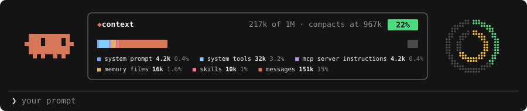

# mini-dock

A small dock above the Claude Code prompt, in one row: a pixel pet, your context window as a stacked bar, and your usage limits as two rings.



The pet and the rings are drawn by the plugin's own code; the numbers in the context bar are sample values.

It is one plugin, [`dock`](mods/dock). `/dock` shows or hides the three parts together or one at a time.

## Install

```bash
claude plugin install dock@mini-dock --marketplace charanteja-200/mini-dock
```

On a Claude Code without `--marketplace`, add the marketplace first:

```bash
claude plugin marketplace add charanteja-200/mini-dock
claude plugin install dock@mini-dock
```

Start a new `claude` session in a terminal, or run `/reload-plugins` in one that is open.

If you installed the earlier separate plugins (`pixel-pet`, `context-bar`, `status-ring`), uninstall them: `dock` now includes all three, and they would draw their own rows as well.

## Commands

Each command flips its part when run alone, and takes `on`, `off` or `status`.

| Command | Does |
| --- | --- |
| `/dock` | Hides all three if any is showing, otherwise shows all three |
| `/dock on`, `/dock off` | Shows or hides all three |
| `/dock status` | Says which are showing |
| `/dock pet`, `/dock bar`, `/dock ring` | Flips just that one; `/dock ring off` sets it; several may be named |
| `/pixel-pet`, `/context-bar`, `/status-ring` | The same for one part |

The choice is remembered across sessions. What each part shows, and how the row is laid out, is in the [plugin's README](mods/dock/README.md).

## Requirements and limits

- A Claude Code recent enough to run plugin mods; tested on 2.1.323.
- It draws only in the terminal (not the desktop app, and not the chat panel of an editor extension; use the editor's integrated terminal). The terminal needs true color.
- The rings need an account that reports usage limits; without one they draw nothing.
- While a permission dialog is open Claude Code hides the whole band.

## Uninstall

```bash
claude plugin uninstall dock@mini-dock
claude plugin marketplace remove mini-dock
```

## Development

`claude plugin test mods/dock` runs the tests. The pictures in `docs/` are rendered from the plugin's code with `bun scripts/render-docs.ts`.

## Credits and licences

Everything here is MIT. Two of the dock's parts are modified copies of other people's work and keep their own licence files and credit, in [`mods/dock/LICENSES`](mods/dock/LICENSES).

| Part | Author | Notes |
| --- | --- | --- |
| The dock, the usage rings, `/dock`, this documentation | Charan Teja | [LICENSE](LICENSE) |
| Pixel pet | Damir, [heydamir/termling](https://github.com/heydamir/termling) | Modified copy of the plugin part; see [what differs](mods/dock/README.md#where-the-parts-come-from). [Licence](mods/dock/LICENSES/pixel-pet-termling.txt) |
| Context bar | Hamza Zafar, [hamzafer/claude-code-mods](https://github.com/hamzafer/claude-code-mods) | Modified copy; see [what differs](mods/dock/README.md#where-the-parts-come-from). [Licence](mods/dock/LICENSES/context-bar-claude-code-mods.txt) |

An unofficial project, not affiliated with or endorsed by Anthropic.
