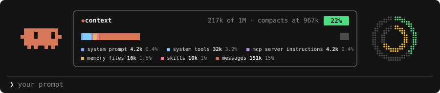
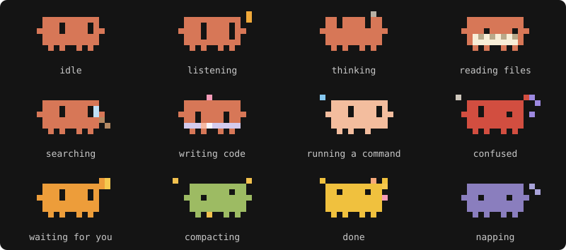

# dock

A dock above the Claude Code prompt, in one row: a pixel pet, your context window as a stacked bar, and your usage limits as two rings. One plugin draws the whole row.

The pet and the rings are drawn by the plugin's own code; the numbers in the context bar are sample values.

## Commands

Each command flips its part when run alone, and takes `on`, `off` or `status`.

| Command | Does |
| --- | --- |
| `/dock` | Hides all three if any is showing, otherwise shows all three |
| `/dock on`, `/dock off` | Shows or hides all three |
| `/dock status` | Says which are showing |
| `/dock pet`, `/dock bar`, `/dock ring` | Flips just that one |
| `/dock ring off`, `/dock pet bar on` | Sets one or several; the words `pixel-pet`, `context-bar` and `status-ring` work too |
| `/pixel-pet`, `/context-bar`, `/status-ring` | The same for one part |

`/dock` sends everything the same way, so the parts cannot end up out of step, and answers with how all three stand. The choice is remembered across sessions.

## The parts

**Pixel pet.** A tiny critter, 16 by 4 cells, that reacts to what the session is doing. Its colour, face and props change with the state of the session:

| Mood | Colour | What it means | What triggers it |
| --- | --- | --- | --- |
| idle | orange | Nothing is happening | A session starts, a turn is stopped, or a compaction finishes. It falls asleep after 45 seconds. |
| listening | orange | It heard you | You send a prompt. It lasts about a second, then it is thinking. |
| thinking | orange, a spark above | Working between steps | The gaps between tool calls, the Task tool (subagents), and any tool it does not know. |
| reading files | orange, holding a page | Reading | `Read`, `NotebookRead`, `WebFetch` |
| searching | orange, a magnifier | Looking for something | `Grep`, `Glob`, `LS`, `WebSearch` |
| writing code | orange, at a keyboard | Changing files | `Edit`, `MultiEdit`, `Write`, `NotebookEdit`, `TodoWrite` |
| running a command | peach, a sweat drop | Running something | `Bash` and its output, and every MCP tool |
| confused | red, puffing steam | Something went wrong | A tool call failed (back to thinking after about 2.6 seconds), or the turn ended in an error (back to idle after 3 seconds). |
| waiting for you | amber, a bell | It needs your answer | A permission request is open. It returns to what it was doing once you answer. |
| compacting | green, dizzy eyes | Making room in the context | The conversation is being compacted. It lasts up to 12 seconds, then idle. |
| done | gold, confetti | The turn is finished | Claude stops its turn. It lasts about 3.4 seconds, then idle. |
| napping | lavender, drifting Zs | Quiet | The idle-prompt notification, the end of the session, or 45 seconds of idle. |

**Context bar.** The window as one stacked bar, a colour per category as `/context` draws them (system prompt, tools, memory files, skills, messages and so on), free space left blank, the compaction buffer shaded, and a legend of the used categories with their tokens and share. The header gives what is used and where auto-compaction starts. It refreshes after each turn.

**Usage rings.** The 5-hour limit is the outer ring and the weekly limit the inner one. The outer ring goes green, amber, then rose as it fills (amber from 50%, rose from 80%). The inner ring is coloured by pace instead: a budget that climbs evenly from 0 when the week resets to 98% when it ends, so 30% used on the first day is rose, not green. Hover a ring to see its percentage in the middle and, in a small card beside it, when that window resets in your local time (`resets 2:30 PM` or `resets 4 PM` for the 5-hour ring, with the weekday for the weekly one: `resets Mon 2:30 AM`). The rings need an account that reports usage limits; without one they draw nothing.

## How the row fits together

Claude Code stacks each plugin's tree as its own row and does not let one plugin lay out another's, so separate plugins for the pet, the bar and the rings cannot share a row. This one plugin holds all three and draws them side by side: the pet and the rings are fixed-size boxes, and the bar takes whatever width is left between them (it is laid out by flex, so nothing has to tell it how wide that is). The pet and the rings are centred against the bar.

If the room left for the bar would be under 30 columns, the rings are dropped, then the pet. The legend lists only the used categories and wraps as the width requires, so on a narrow terminal the bar grows taller than the rings.

Claude Code reads a plugin's one hooks module statically, so every hook is in `hooks/register.tsx`; what each part knows and draws lives in `hooks/bar.tsx`, `hooks/ring.tsx` (with `hooks/rings.ts`), `hooks/pet/` and `hooks/command.ts`.

## Limits

- It draws only in the terminal, not in the desktop app or the chat panel of an editor extension (use the editor's integrated terminal), and needs a terminal with true color.
- While a permission dialog is open Claude Code hides the whole band, so the pet's "waiting for you" shows only as the dialog closes.
- Where an organization manages Claude Code, the permission, notification and compaction events skip personally installed plugins, so those pet moods do not show.

## Coming from the separate plugins

Versions before 0.2.0 were four plugins: `dock`, `pixel-pet`, `context-bar` and `status-ring`. They stopped fitting in one row when Claude Code 2.1.323 changed how plugins' bands compose, and `dock` now includes all three parts. Uninstall `pixel-pet`, `context-bar` and `status-ring`, or they will draw their own rows as well. Which parts were hidden is not carried over; the settings are stored under the dock now.

## Where the parts come from

- **Pixel pet** is a modified copy of the plugin part of [heydamir/termling](https://github.com/heydamir/termling) 0.2.0 by Damir, used under its MIT licence ([licence](LICENSES/pixel-pet-termling.txt), his, unchanged). Only the plugin is included, not termling's browser page, its npx helper or its React component. What differs: it is drawn at half size, 16 by 4 cells, with half-block characters; the mood word and note are not shown (there is no room in a single row); it is drawn as part of the dock's row; the command is `/pixel-pet` and takes `on`, `off` and `status`.
- **Context bar** is a modified copy of `context-bar` from [hamzafer/claude-code-mods](https://github.com/hamzafer/claude-code-mods) by Hamza Zafar, used under its MIT licence ([licence](LICENSES/context-bar-claude-code-mods.txt), his, unchanged). What differs: free space is drawn blank instead of as a line; the bar and the legend are laid out by flex in the width they are given; the legend lists only the used categories; it is drawn as part of the dock's row; the command takes `on`, `off` and `status`.
- **Usage rings, the dock row and `/dock`** are original work, MIT, see [LICENSE](LICENSE).

An unofficial fan project, not affiliated with or endorsed by Anthropic.

Part of [mini-dock](../..).
